# Assessment 06 – GitOps with Argo CD on Minikube

This document describes how Argo CD was installed in the Minikube cluster built in the previous assessments, how it was exposed through Traefik using a domain name, how it was connected to this GitHub repository (branch `assessment-06`), and how two Argo CD `Application` resources deploy the web applications of the `parcial-reaga` namespace following the GitOps approach. It also documents a change made in the repository (scaling a Deployment) and how Argo CD synchronized it.

Everything is defined as code (YAML files in this branch), including the Argo CD `Application` definitions.

---

## Table of contents

1. [Summary](#1-summary)
2. [Environment](#2-environment)
3. [Repository layout](#3-repository-layout)
4. [Step 0 – Starting point (reusing assessment-02)](#4-step-0--starting-point-reusing-assessment-02)
5. [Step 1 – Start Minikube and check the cluster](#5-step-1--start-minikube-and-check-the-cluster)
6. [Step 2 – Create the `assessment-06` branch from `main`](#6-step-2--create-the-assessment-06-branch-from-main)
7. [Step 3 – Install Argo CD in `argocd-reaga`](#7-step-3--install-argo-cd-in-argocd-reaga)
8. [Step 4 – Expose Argo CD through Traefik](#8-step-4--expose-argo-cd-through-traefik)
9. [Step 5 – Domain name and browser access from Windows](#9-step-5--domain-name-and-browser-access-from-windows)
10. [Step 6 – Connect Argo CD to the GitHub repository](#10-step-6--connect-argo-cd-to-the-github-repository)
11. [Step 7 – Split the manifests and create the Applications](#11-step-7--split-the-manifests-and-create-the-applications)
12. [Step 8 – Applications in `Synced` and `Healthy` (before the change)](#12-step-8--applications-in-synced-and-healthy-before-the-change)
13. [Step 9 – Change in the repository and automatic sync (after the change)](#13-step-9--change-in-the-repository-and-automatic-sync-after-the-change)
14. [Requirements checklist](#14-requirements-checklist)
15. [Problems found and observations](#15-problems-found-and-observations)
16. [Quick reproduction (all commands)](#16-quick-reproduction-all-commands)

---

## 1. Summary

| Item | Value |
| --- | --- |
| Repository | `https://github.com/RaulvGuti/Tareas-virtualizacion.git` (public) |
| Branch | `assessment-06` (created from `main`) |
| Argo CD namespace | `argocd-reaga` |
| Argo CD installation method | Helm chart `argo/argo-cd`, release name `argocd` |
| Argo CD domain | `argocd.reaga.test` |
| Ingress controller | Traefik (installed in assessment-02, namespace `traefik`) |
| LoadBalancer IP (MetalLB) | `192.168.49.240` |
| Application namespace | `parcial-reaga` |
| Argo CD Applications | `parcial-web-a` (nginx + apache) and `parcial-web-b` (whoami + hello) |
| Change tested | `web-nginx` Deployment: `replicas: 1` → `replicas: 2` |

---

## 2. Environment

- Windows 11 Home, Docker Desktop, Minikube v1.39.0 with the **docker** driver (single node, Kubernetes v1.37.0).
- `kubectl`, `helm` and `git` used from Windows PowerShell.
- MetalLB and Traefik already installed from assessment-02 (Traefik is a `LoadBalancer` Service with the MetalLB IP `192.168.49.240`).
- Argo CD v3.5.5 (version shown in the web interface).

---

## 3. Repository layout

Files added in this branch:

```text
README.md
assessment-06/
├── argocd-values.yaml          # Helm values for the Argo CD installation
├── argocd-ingress.yaml         # Ingress (Traefik) for the Argo CD web interface
├── argocd-applications.yaml    # The two Argo CD Application definitions
└── apps/
    ├── web-group-a/            # Application parcial-web-a
    │   ├── nginx.yaml
    │   └── apache.yaml
    └── web-group-b/            # Application parcial-web-b
        ├── whoami.yaml
        └── hello.yaml
images/                         # Screenshots used in this README
```

Each file in `apps/` contains the `Deployment`, the `Service` and the `Ingress` of one web application, in the namespace `parcial-reaga`.

---

## 4. Step 0 – Starting point (reusing assessment-02)

Before starting from scratch, the repository and the cluster were reviewed to find out if a previous assignment could be reused. The branch `assessment-02` (MetalLB + Traefik + four web applications in the namespace `parcial-reaga`, exposed with the domains `*.reaga.test`) already met the requirements for this task, and it was already pushed to GitHub (`apps.yaml`, `ingress.yaml`, `metallb-config.yaml`, `traefik-values.yaml`).

Commands:

```powershell
git status
git branch -a
git ls-tree -r --name-only origin/assessment-02
```

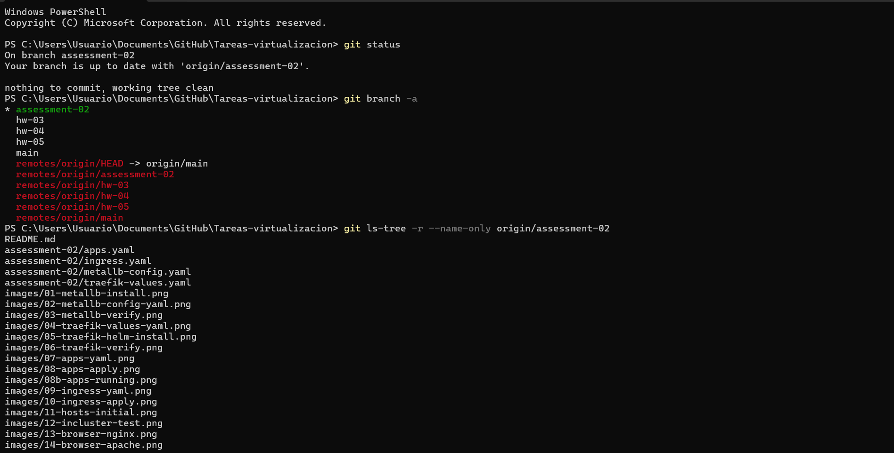

The cluster check showed that Minikube was stopped, so `kubectl` could not connect to the API server:

```powershell
minikube status
kubectl get pods -A
kubectl get svc -n traefik
kubectl get all -n parcial-reaga
```

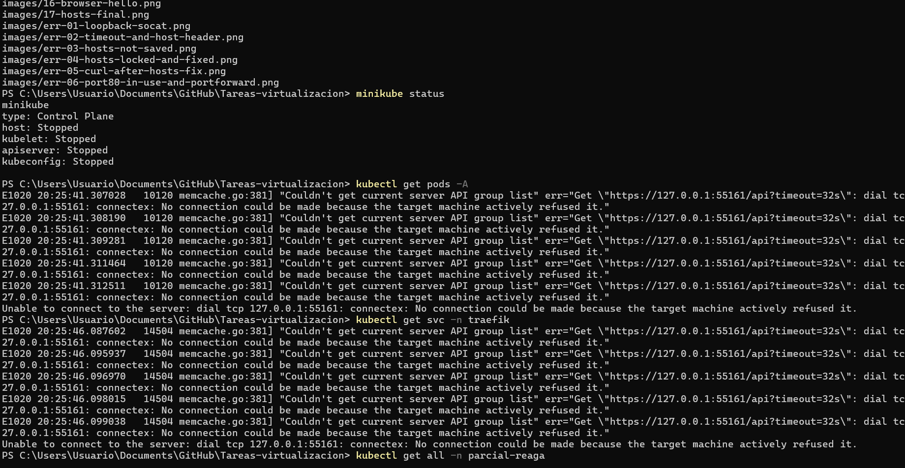

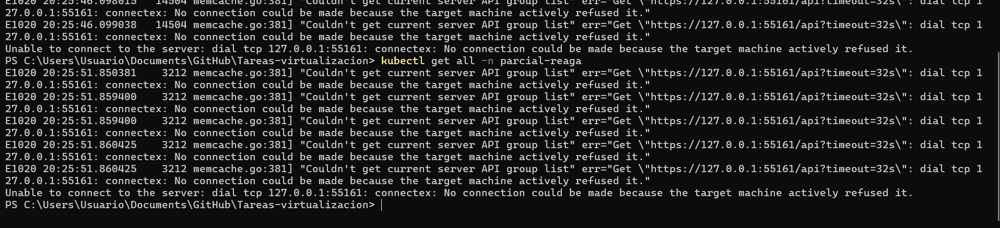

---

## 5. Step 1 – Start Minikube and check the cluster

Docker Desktop must be running first. Then:

```powershell
minikube start
kubectl get nodes
kubectl get pods -A
kubectl get svc -n traefik
kubectl get pods -n parcial-reaga
```

Expected result: node `Ready`, the pods of `metallb-system`, `traefik` and `parcial-reaga` in `Running`, and the Traefik Service with `EXTERNAL-IP` `192.168.49.240`.

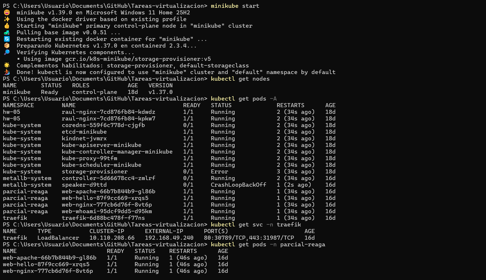

Some system pods appeared as not ready for a few seconds right after the restart (see [section 15](#15-problems-found-and-observations)); they recovered by themselves.

---

## 6. Step 2 – Create the `assessment-06` branch from `main`

The branch was created from `main`, as required:

```powershell
git checkout main
git pull origin main
git checkout -b assessment-06
```

The manifests of the four web applications were taken from `assessment-02` (that branch is not modified) and moved to a working folder in the new branch:

```powershell
git checkout origin/assessment-02 -- assessment-02/apps.yaml assessment-02/ingress.yaml
mkdir assessment-06\apps
git mv assessment-02/apps.yaml assessment-06/apps/apps.yaml
git mv assessment-02/ingress.yaml assessment-06/apps/ingress.yaml
git status
```

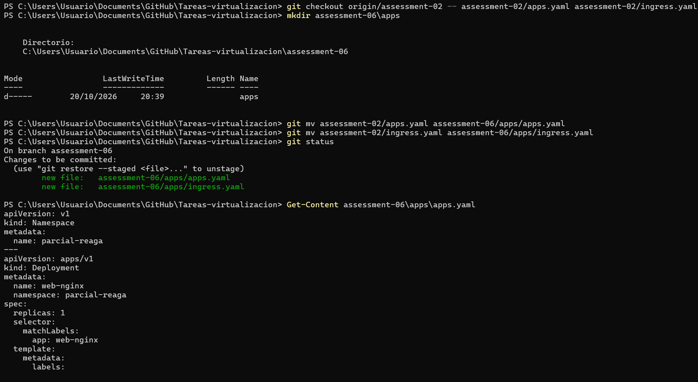

The content of both files was reviewed before splitting them (they are later replaced by the two folders described in [Step 7](#11-step-7--split-the-manifests-and-create-the-applications)):

```powershell
Get-Content assessment-06\apps\apps.yaml
Get-Content assessment-06\apps\ingress.yaml
```

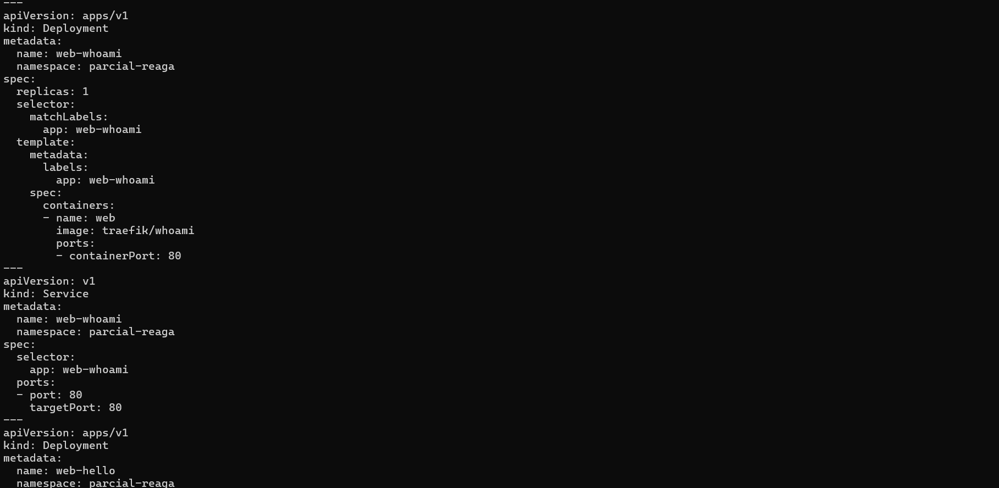

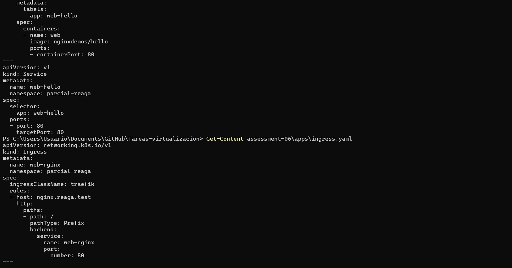

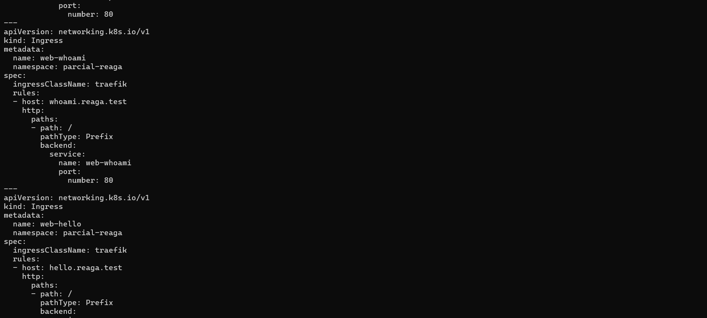

The same files, viewed in the editor and in the terminal:

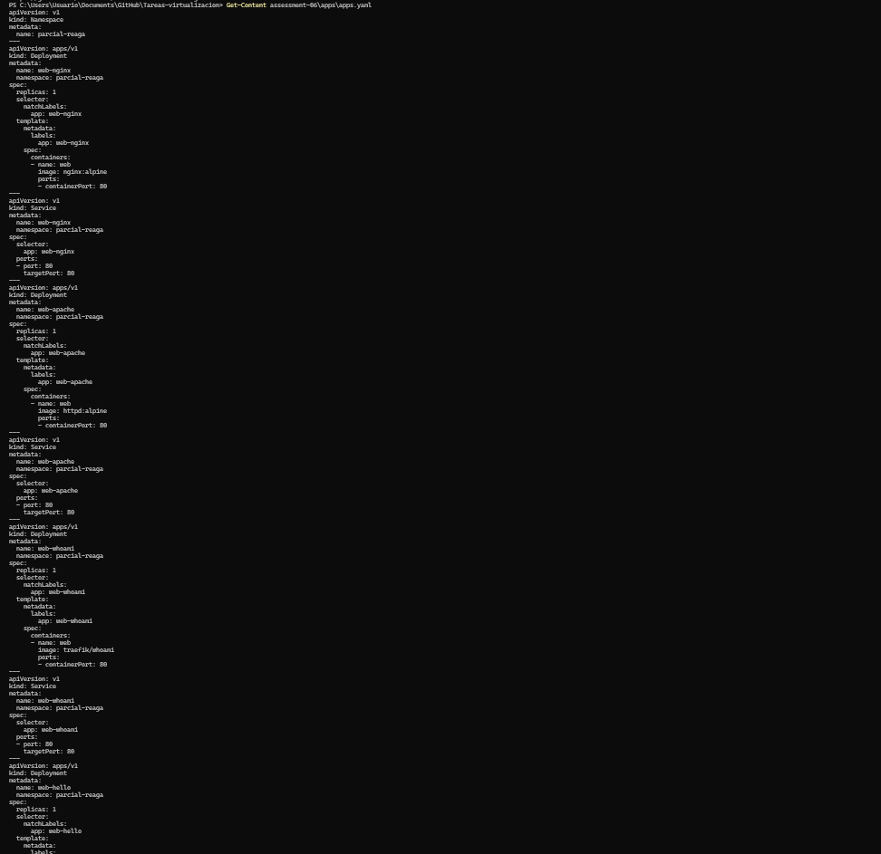

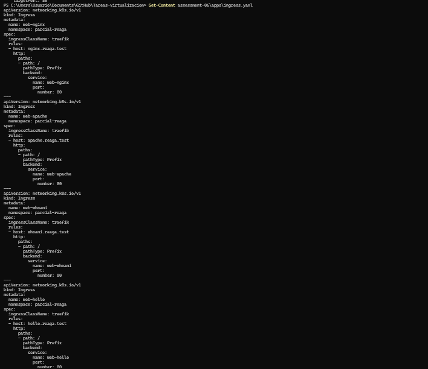

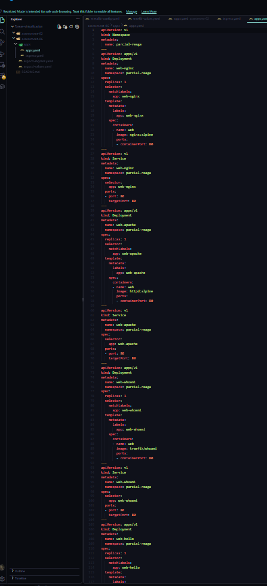

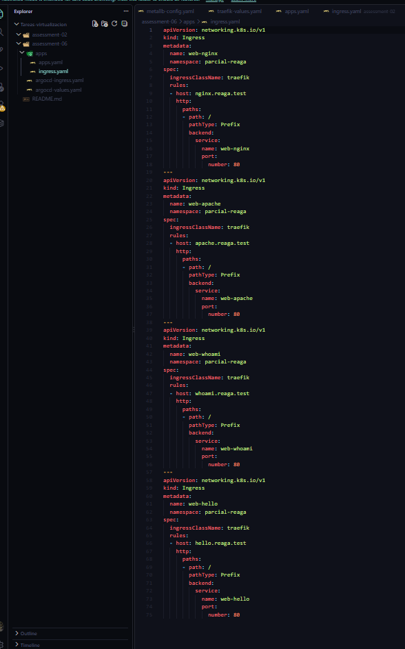

---

## 7. Step 3 – Install Argo CD in `argocd-reaga`

The namespace name follows the required pattern `argocd-` + initials (`reaga`). Argo CD was installed with Helm, because the official plain manifest has the `argocd` namespace hard-coded in some permissions and does not work well in a different namespace.

### 7.1 Add the Helm repository and create the namespace

```powershell
helm repo add argo https://argoproj.github.io/argo-helm
helm repo update
kubectl create namespace argocd-reaga
```

### 7.2 Helm values (IaC) – `assessment-06/argocd-values.yaml`

```yaml
global:
  domain: argocd.reaga.test
configs:
  params:
    server.insecure: true
dex:
  enabled: false
notifications:
  enabled: false
```

- `global.domain`: domain used by Argo CD for its own URLs.
- `configs.params.server.insecure: true`: Argo CD serves plain HTTP inside the cluster, so Traefik can expose it without dealing with certificates (TLS termination is not needed for this lab).
- `dex` and `notifications` are disabled to save resources in Minikube (neither is needed in this task).

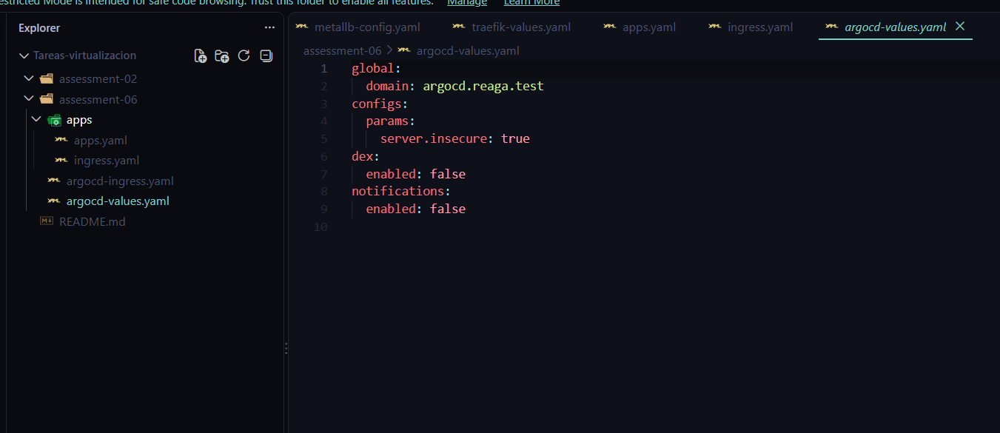

### 7.3 Install

```powershell
helm install argocd argo/argo-cd -n argocd-reaga -f assessment-06\argocd-values.yaml
```

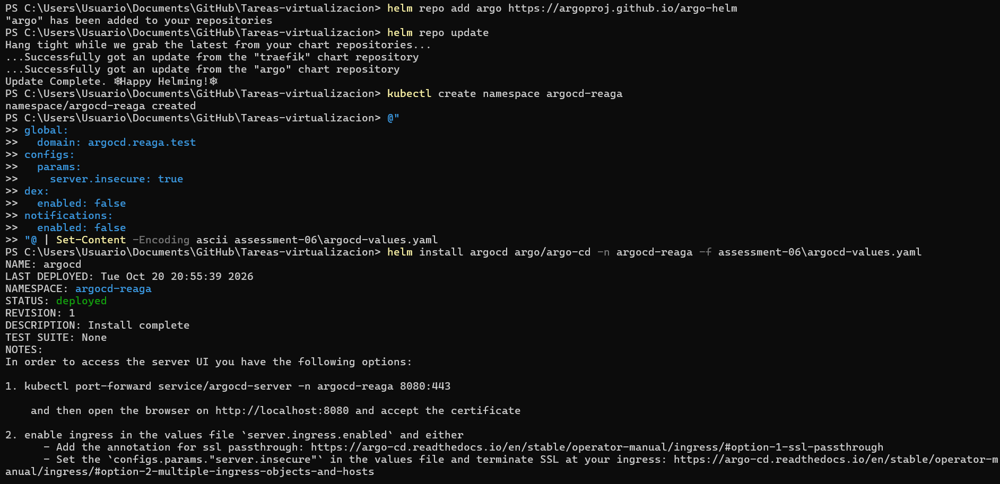

### 7.4 Verify

```powershell
kubectl get pods -n argocd-reaga
kubectl get svc -n argocd-reaga
```

All the Argo CD pods (`application-controller`, `applicationset-controller`, `redis`, `repo-server` and `server`) are `Running` and `1/1`. The `argocd-server` Service listens on ports 80 and 443 inside the cluster.

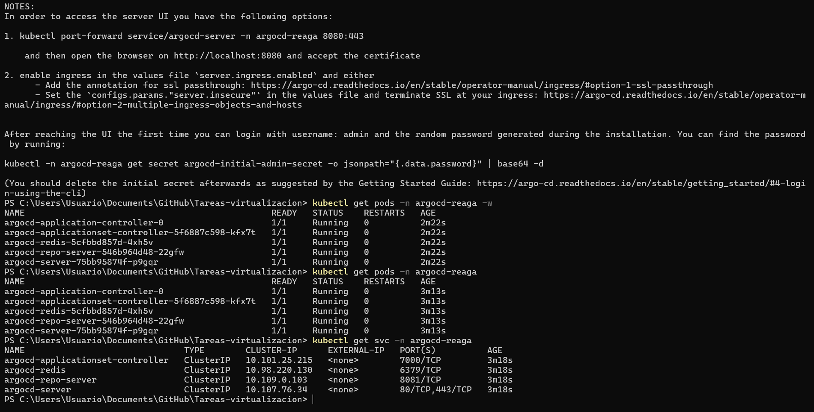

---

## 8. Step 4 – Expose Argo CD through Traefik

### 8.1 Check the IngressClass

```powershell
kubectl get ingressclass
```

The class `traefik` (default) exists, controlled by `traefik.io/ingress-controller`.

### 8.2 Ingress (IaC) – `assessment-06/argocd-ingress.yaml`

```yaml
apiVersion: networking.k8s.io/v1
kind: Ingress
metadata:
  name: argocd-server
  namespace: argocd-reaga
spec:
  ingressClassName: traefik
  rules:
    - host: argocd.reaga.test
      http:
        paths:
          - path: /
            pathType: Prefix
            backend:
              service:
                name: argocd-server
                port:
                  number: 80
```

The Ingress routes the host `argocd.reaga.test` to port 80 (HTTP) of the `argocd-server` Service, which works because `server.insecure` is enabled.

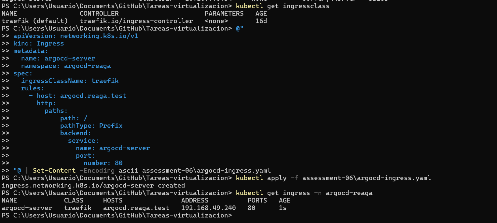

The file in the editor:

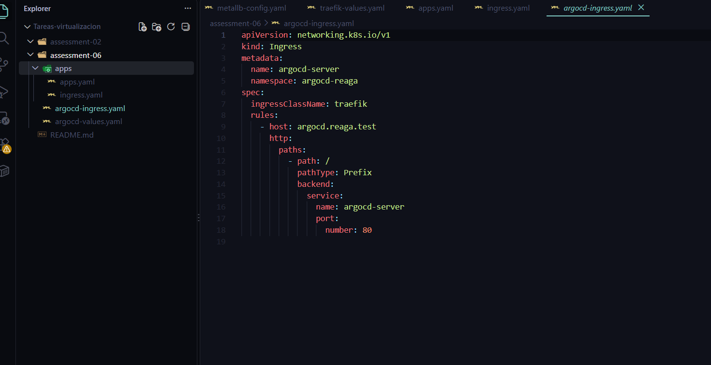

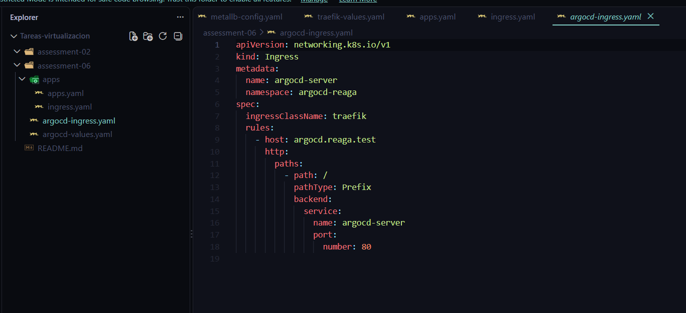

### 8.3 Apply and test inside the cluster

```powershell
kubectl apply -f assessment-06\argocd-ingress.yaml
kubectl get ingress -n argocd-reaga
minikube ssh "curl -s -o /dev/null -w '%{http_code}' -H 'Host: argocd.reaga.test' http://192.168.49.240"
```

The Ingress gets the address `192.168.49.240` (the MetalLB IP of the Traefik LoadBalancer), and the request made from inside Minikube with the header `Host: argocd.reaga.test` returns HTTP **200**.

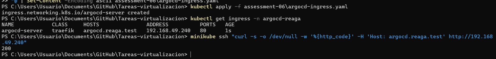

---

## 9. Step 5 – Domain name and browser access from Windows

### 9.1 `hosts` file

The domain `argocd.reaga.test` has to resolve to the Traefik LoadBalancer IP. The real LoadBalancer IP is `192.168.49.240`, but **with the Docker driver of Minikube on Windows that IP is not reachable from the Windows host** (the same limitation documented in assessment-02). For that reason, the domain was mapped to `127.0.0.1` and Traefik is reached through a `kubectl port-forward`.

The `hosts` file was edited with a PowerShell opened as Administrator:

```powershell
notepad C:\Windows\System32\drivers\etc\hosts
```

Line added at the end of the file, next to the other `reaga.test` domains:

```text
127.0.0.1 argocd.reaga.test
```

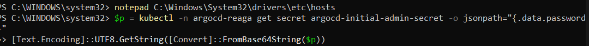

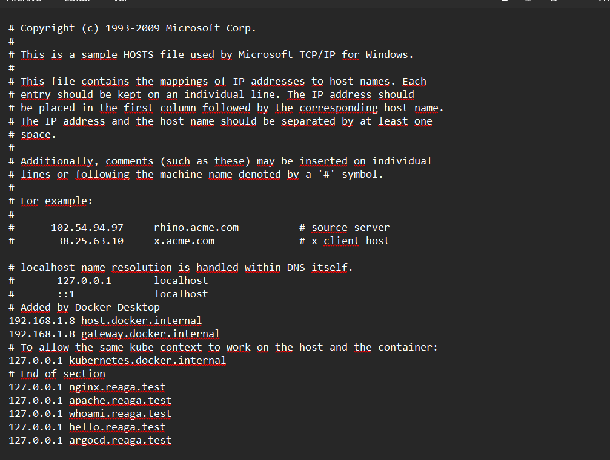

> If the cluster IP were reachable from the host, the line would be `192.168.49.240 argocd.reaga.test`, which is the IP of the Traefik LoadBalancer.

### 9.2 Port-forward to Traefik

In a PowerShell that stays open during the whole session:

```powershell
kubectl port-forward -n traefik svc/traefik 8080:80
```

Port `8080` is used because port 80 of Windows was already in use (see assessment-02).

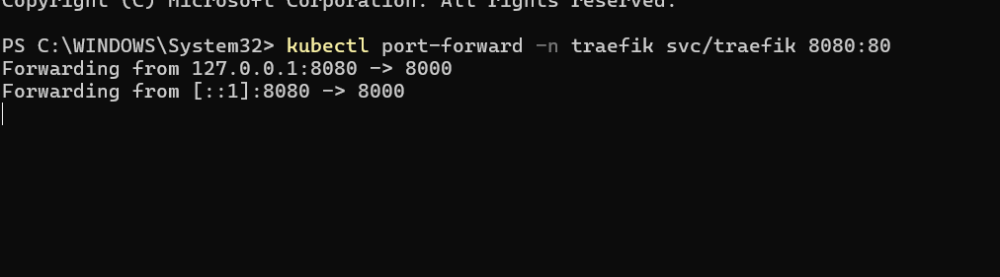

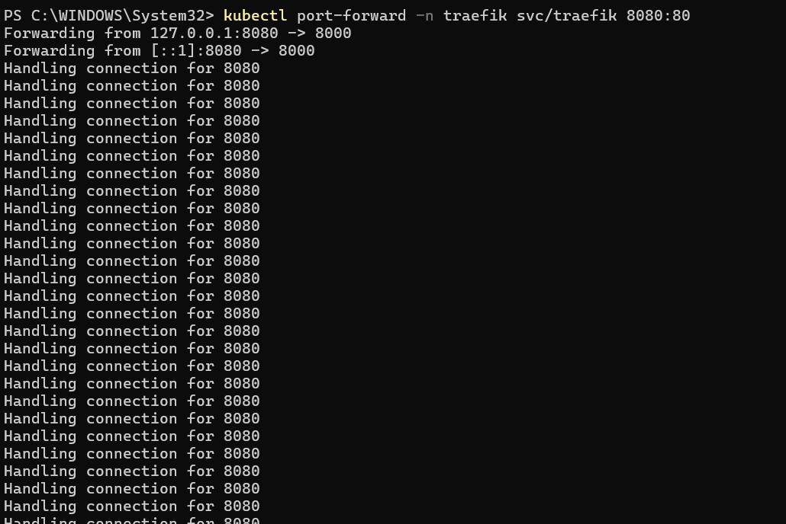

### 9.3 Open Argo CD by domain name

URL: `http://argocd.reaga.test:8080`

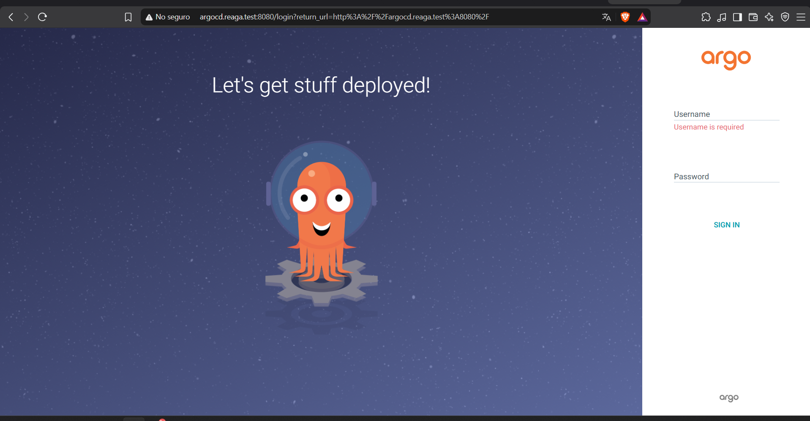

### 9.4 Initial admin password

User: `admin`. The password is stored by Argo CD in a Secret:

```powershell
$p = kubectl -n argocd-reaga get secret argocd-initial-admin-secret -o jsonpath="{.data.password}"
[Text.Encoding]::UTF8.GetString([Convert]::FromBase64String($p))
```

After logging in, the Applications page is empty (no Application has been created yet):

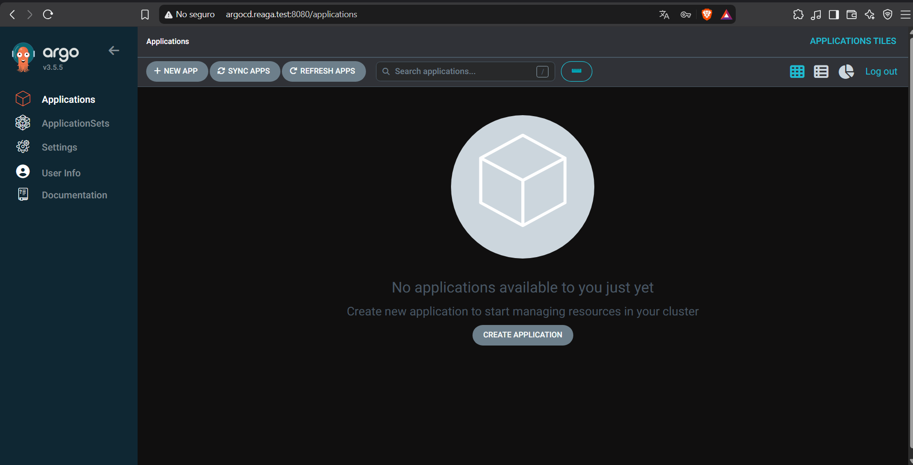

---

## 10. Step 6 – Connect Argo CD to the GitHub repository

The repository is **public**, so Argo CD can read it without credentials (no Secret or token is needed). The connection is declared inside each `Application` (`spec.source`):

- `repoURL`: `https://github.com/RaulvGuti/Tareas-virtualizacion.git`
- `targetRevision`: `assessment-06` (the branch of this task)
- `path`: the folder with the YAML files that Argo CD must deploy

The repository URL was obtained with:

```powershell
git remote get-url origin
```

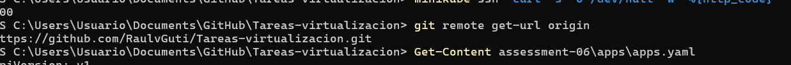

---

## 11. Step 7 – Split the manifests and create the Applications

### 11.1 Manifests split in two groups

The four applications were split in two folders, one per Argo CD Application:

- `assessment-06/apps/web-group-a/` → `nginx.yaml` and `apache.yaml`
- `assessment-06/apps/web-group-b/` → `whoami.yaml` and `hello.yaml`

They are the same Deployments, Services and Ingresses of assessment-02 (same images and domains), only reorganized, one file per application. The temporary files `apps.yaml` and `ingress.yaml` were removed. The files were generated with a small PowerShell helper function (`New-Web`) that writes the Deployment, the Service and the Ingress of one application:

```powershell
Remove-Item -Recurse -Force assessment-06\apps

function New-Web($name, $image, $hostName) {
@"
apiVersion: apps/v1
kind: Deployment
metadata:
  name: web-$name
  namespace: parcial-reaga
spec:
  replicas: 1
  selector:
    matchLabels:
      app: web-$name
  template:
    metadata:
      labels:
        app: web-$name
    spec:
      containers:
      - name: web
        image: $image
        ports:
        - containerPort: 80
---
apiVersion: v1
kind: Service
metadata:
  name: web-$name
  namespace: parcial-reaga
spec:
  selector:
    app: web-$name
  ports:
  - port: 80
    targetPort: 80
---
apiVersion: networking.k8s.io/v1
kind: Ingress
metadata:
  name: web-$name
  namespace: parcial-reaga
spec:
  ingressClassName: traefik
  rules:
  - host: $hostName
    http:
      paths:
      - path: /
        pathType: Prefix
        backend:
          service:
            name: web-$name
            port:
              number: 80
"@
}

New-Item -ItemType Directory -Force assessment-06\apps\web-group-a, assessment-06\apps\web-group-b | Out-Null
New-Web "nginx"  "nginx:alpine"     "nginx.reaga.test"  | Set-Content -Encoding ascii assessment-06\apps\web-group-a\nginx.yaml
New-Web "apache" "httpd:alpine"     "apache.reaga.test" | Set-Content -Encoding ascii assessment-06\apps\web-group-a\apache.yaml
New-Web "whoami" "traefik/whoami"   "whoami.reaga.test" | Set-Content -Encoding ascii assessment-06\apps\web-group-b\whoami.yaml
New-Web "hello"  "nginxdemos/hello" "hello.reaga.test"  | Set-Content -Encoding ascii assessment-06\apps\web-group-b\hello.yaml
```

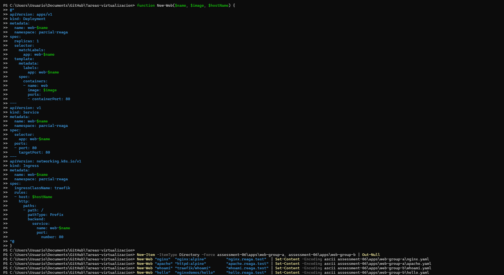

Example of a resulting file, `assessment-06/apps/web-group-a/nginx.yaml` (state at the beginning, with 1 replica):

```yaml
apiVersion: apps/v1
kind: Deployment
metadata:
  name: web-nginx
  namespace: parcial-reaga
spec:
  replicas: 1
  selector:
    matchLabels:
      app: web-nginx
  template:
    metadata:
      labels:
        app: web-nginx
    spec:
      containers:
      - name: web
        image: nginx:alpine
        ports:
        - containerPort: 80
---
apiVersion: v1
kind: Service
metadata:
  name: web-nginx
  namespace: parcial-reaga
spec:
  selector:
    app: web-nginx
  ports:
  - port: 80
    targetPort: 80
---
apiVersion: networking.k8s.io/v1
kind: Ingress
metadata:
  name: web-nginx
  namespace: parcial-reaga
spec:
  ingressClassName: traefik
  rules:
  - host: nginx.reaga.test
    http:
      paths:
      - path: /
        pathType: Prefix
        backend:
          service:
            name: web-nginx
            port:
              number: 80
```

The final folder structure in the editor:

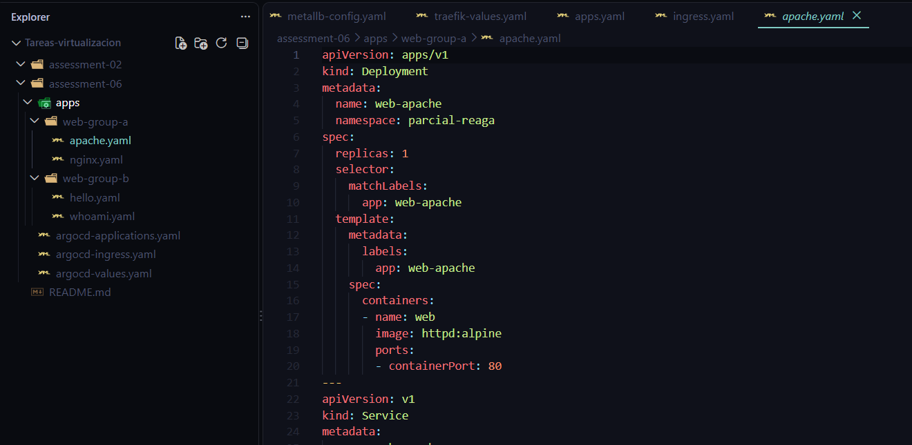

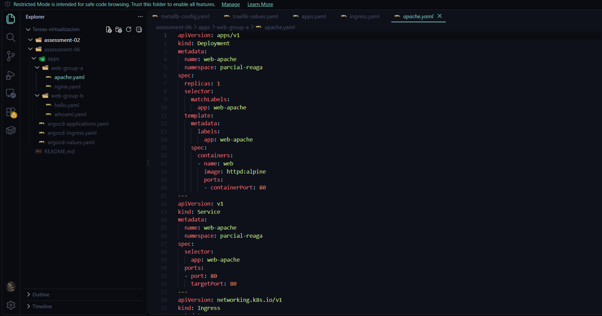

### 11.2 Argo CD Applications (IaC) – `assessment-06/argocd-applications.yaml`

```yaml
apiVersion: argoproj.io/v1alpha1
kind: Application
metadata:
  name: parcial-web-a
  namespace: argocd-reaga
spec:
  project: default
  source:
    repoURL: https://github.com/RaulvGuti/Tareas-virtualizacion.git
    targetRevision: assessment-06
    path: assessment-06/apps/web-group-a
  destination:
    server: https://kubernetes.default.svc
    namespace: parcial-reaga
  syncPolicy:
    automated:
      prune: true
      selfHeal: true
    syncOptions:
    - CreateNamespace=true
---
apiVersion: argoproj.io/v1alpha1
kind: Application
metadata:
  name: parcial-web-b
  namespace: argocd-reaga
spec:
  project: default
  source:
    repoURL: https://github.com/RaulvGuti/Tareas-virtualizacion.git
    targetRevision: assessment-06
    path: assessment-06/apps/web-group-b
  destination:
    server: https://kubernetes.default.svc
    namespace: parcial-reaga
  syncPolicy:
    automated:
      prune: true
      selfHeal: true
    syncOptions:
    - CreateNamespace=true
```

Meaning of the main fields:

- `metadata.namespace: argocd-reaga`: the `Application` objects live in the Argo CD namespace.
- `source.repoURL` / `targetRevision` / `path`: GitHub repository, branch `assessment-06` and folder with the YAML files (the GitOps source of truth).
- `destination.server: https://kubernetes.default.svc`: the same cluster where Argo CD runs; `destination.namespace: parcial-reaga`: namespace where the applications are deployed.
- `syncPolicy.automated`: Argo CD synchronizes the cluster automatically when the repository changes. `prune: true` removes resources that are deleted from Git and `selfHeal: true` reverts manual changes made directly in the cluster.
- `CreateNamespace=true`: creates `parcial-reaga` if it does not exist.

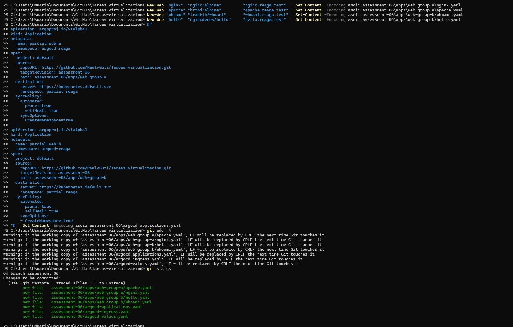

### 11.3 Commit, push and apply

Argo CD reads the manifests from GitHub, so the files must be pushed before creating the Applications:

```powershell
git add -A
git commit -m "feat(assessment-06): add Argo CD config and GitOps app manifests"
git push -u origin assessment-06
git ls-tree -r --name-only origin/assessment-06 | Select-String "assessment-06/"
```

Then the Applications are created in the cluster:

```powershell
kubectl apply -f assessment-06\argocd-applications.yaml
kubectl get applications -n argocd-reaga
kubectl get pods -n parcial-reaga
```

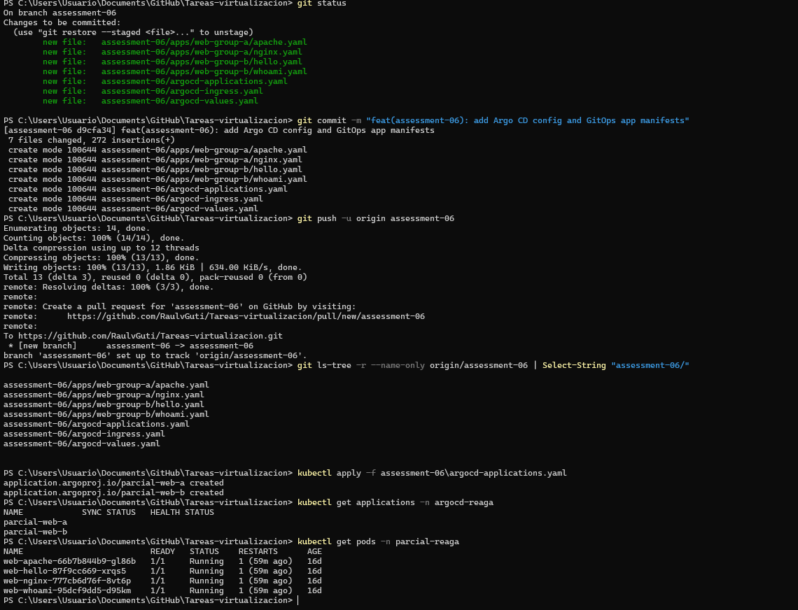

Note that the pods of `parcial-reaga` keep their original age (16 days): they already existed from assessment-02, and Argo CD adopted the existing resources instead of recreating them.

---

## 12. Step 8 – Applications in `Synced` and `Healthy` (before the change)

Both Applications reach `Synced` and `Healthy`, pointing to the branch `assessment-06` and to their own folder, with the destination `in-cluster` and the namespace `parcial-reaga`.

Argo CD web interface (by domain name `argocd.reaga.test`):

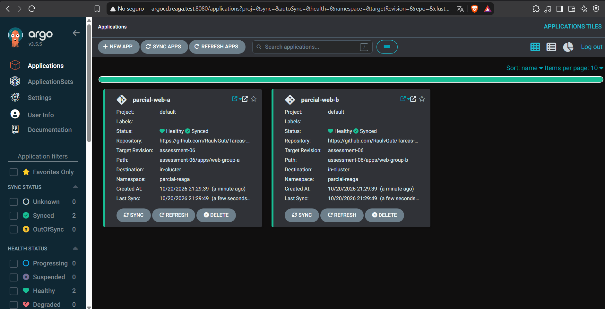

Resource tree of `parcial-web-a` (Ingress, Service, Deployment, ReplicaSet and Pod of nginx and apache). The sync was done from commit `d9cfa34`:

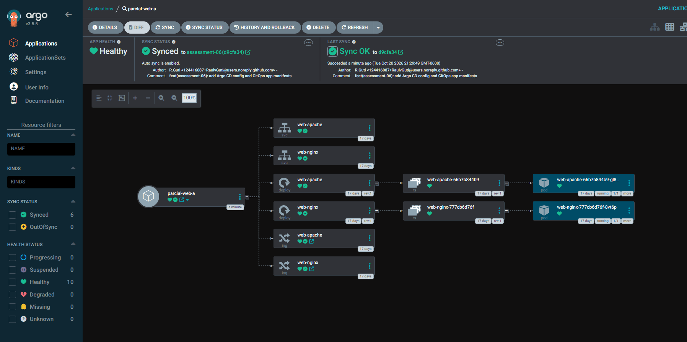

Resource tree of `parcial-web-b` (whoami and hello):

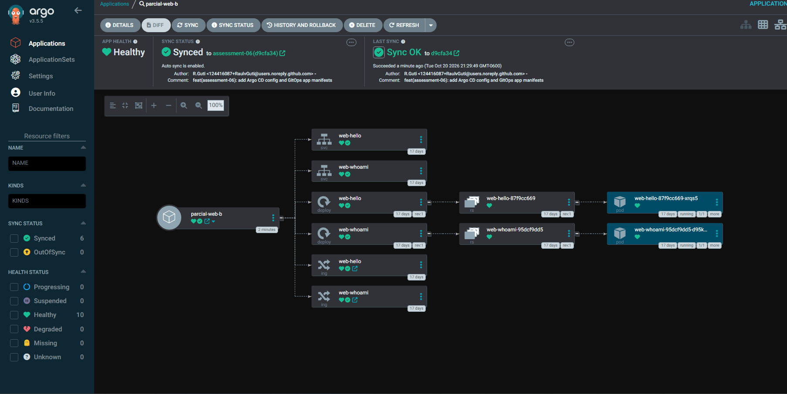

---

## 13. Step 9 – Change in the repository and automatic sync (after the change)

### 13.1 The change

The number of replicas of the `web-nginx` Deployment (Application `parcial-web-a`) was changed from `1` to `2` directly in the repository:

```powershell
(Get-Content assessment-06\apps\web-group-a\nginx.yaml) -replace "replicas: 1", "replicas: 2" | Set-Content -Encoding ascii assessment-06\apps\web-group-a\nginx.yaml
git diff
git add assessment-06\apps\web-group-a\nginx.yaml
git commit -m "feat(assessment-06): scale web-nginx to 2 replicas"
git push
```

`git diff` shows a single changed line: `-  replicas: 1` / `+  replicas: 2`. The push moved the branch from `d9cfa34` to `6e1f991`.

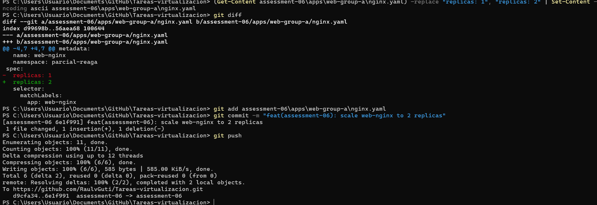

### 13.2 State right after the push

The following capture was taken immediately after the push. Argo CD checks the Git repository periodically (about every 3 minutes by default), so at that moment the Deployment still shows 1 replica and both Applications still appear as `Synced` and `Healthy`: the change had not been detected yet.

```powershell
kubectl get deployment web-nginx -n parcial-reaga
kubectl get pods -n parcial-reaga
kubectl get applications -n argocd-reaga
```

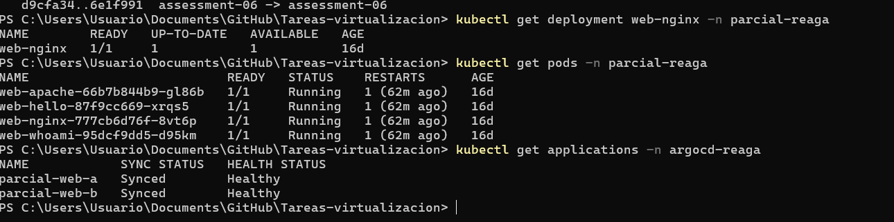

### 13.3 After the synchronization

After Argo CD detected the new commit, `parcial-web-a` was synchronized automatically (`automated` sync policy, no manual action in the cluster). In the web interface, the field **Last Sync** of `parcial-web-a` changed to `10/20/2026 21:33:06`, while `parcial-web-b` kept its previous synchronization (`21:29:49`) because nothing changed in its folder. Both Applications remain `Healthy` and `Synced`.

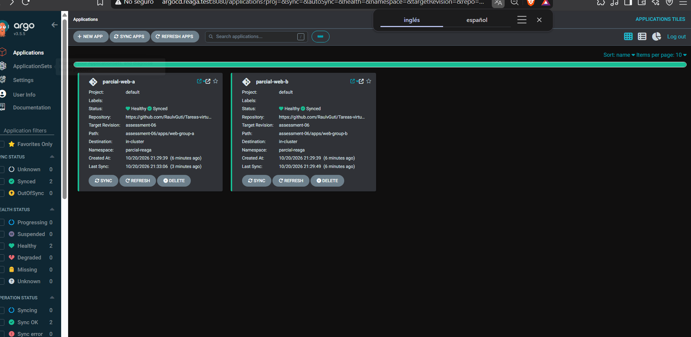

---

## 14. Requirements checklist

| Requirement | Where it is documented |
| --- | --- |
| Argo CD installed in its own namespace `argocd-` + initials (`argocd-reaga`) | [Step 3](#7-step-3--install-argo-cd-in-argocd-reaga) |
| Argo CD web interface exposed through Traefik with a domain in `hosts` | [Step 4](#8-step-4--expose-argo-cd-through-traefik) and [Step 5](#9-step-5--domain-name-and-browser-access-from-windows) |
| Argo CD connected to the GitHub repository, branch `assessment-06` | [Step 6](#10-step-6--connect-argo-cd-to-the-github-repository) and [Step 7](#11-step-7--split-the-manifests-and-create-the-applications) |
| At least two Applications deploying the apps of `parcial-reaga` from YAML files in the repo | [Step 7](#11-step-7--split-the-manifests-and-create-the-applications) (`parcial-web-a` and `parcial-web-b`) |
| Change in the repository synchronized by Argo CD | [Step 9](#13-step-9--change-in-the-repository-and-automatic-sync-after-the-change) |
| All configuration as IaC (YAML), including the Application | `assessment-06/*.yaml` and `assessment-06/apps/` |
| Screenshots of Argo CD accessed by domain name | `a06-17`, `a06-18`, `a06-32`, `a06-37` |
| Screenshots of the Applications in Synced and Healthy, before and after the change | `a06-32` (before) and `a06-37` (after) |

---

## 15. Problems found and observations

1. **Minikube was stopped at the beginning.** `kubectl` returned `connection refused` against `127.0.0.1:55161` because the cluster was not running (screenshots `a06-02` and `a06-03`). Solved by starting Docker Desktop and running `minikube start`; the cluster and the previous workloads came back without being reinstalled (`a06-04`).
2. **Transient pod errors right after the restart.** Immediately after `minikube start`, a few system pods were still starting (for example `coredns` at `0/1`, `storage-provisioner` in `Error` and the MetalLB `speaker` in `CrashLoopBackOff`, visible in `a06-04`). They stabilized by themselves after a short time; this was confirmed because Traefik kept the IP `192.168.49.240` and the in-cluster request to Argo CD returned HTTP 200 (`a06-12`).
3. **The LoadBalancer IP is not reachable from Windows.** With the Docker driver of Minikube, `192.168.49.240` can be reached from inside the Minikube node but not from the Windows host (same issue as in assessment-02). Workaround used: the domain points to `127.0.0.1` in the `hosts` file and Traefik is published with `kubectl port-forward -n traefik svc/traefik 8080:80`; the browser URL is `http://argocd.reaga.test:8080`. Port `8080` is used because port 80 of Windows is already in use.
4. **The `hosts` file needs Administrator rights.** It was edited with `notepad` opened from a PowerShell running as Administrator.
5. **Git warnings `LF will be replaced by CRLF`.** They appear when running `git add` on Windows because the YAML files are created with LF line endings. They are harmless and do not affect Kubernetes or Argo CD.
6. **Empty status right after creating the Applications.** The first `kubectl get applications` run (`a06-31`) shows the Applications without `SYNC STATUS` and `HEALTH STATUS`, because the Argo CD controller had not evaluated them yet. A few seconds later both were `Synced` and `Healthy`.
7. **The sync of the change is not instantaneous.** Right after the push, the Deployment still had 1 replica (`a06-36`) because Argo CD polls the repository periodically (about every 3 minutes by default). Waiting, or pressing **Refresh** in the Argo CD interface, makes it detect the new commit; the automated sync then applies it.
8. **Existing resources were adopted.** The Deployments, Services and Ingresses of `parcial-reaga` were created in assessment-02 with `kubectl apply`. Argo CD took control of them without recreating the pods (the pods keep an age of 16 days).

---

## 16. Quick reproduction (all commands)

```powershell
# 0. Start the cluster (Docker Desktop running)
minikube start
kubectl get pods -A

# 1. Branch from main
git checkout main
git pull origin main
git checkout -b assessment-06

# 2. Install Argo CD in argocd-reaga
helm repo add argo https://argoproj.github.io/argo-helm
helm repo update
kubectl create namespace argocd-reaga
helm install argocd argo/argo-cd -n argocd-reaga -f assessment-06\argocd-values.yaml
kubectl get pods -n argocd-reaga

# 3. Expose with Traefik
kubectl apply -f assessment-06\argocd-ingress.yaml
kubectl get ingress -n argocd-reaga

# 4. hosts (Administrator): 127.0.0.1 argocd.reaga.test
notepad C:\Windows\System32\drivers\etc\hosts
kubectl port-forward -n traefik svc/traefik 8080:80
# Browser: http://argocd.reaga.test:8080  (user: admin)
$p = kubectl -n argocd-reaga get secret argocd-initial-admin-secret -o jsonpath="{.data.password}"
[Text.Encoding]::UTF8.GetString([Convert]::FromBase64String($p))

# 5. Push the branch and create the Applications
git add -A
git commit -m "feat(assessment-06): add Argo CD config and GitOps app manifests"
git push -u origin assessment-06
kubectl apply -f assessment-06\argocd-applications.yaml
kubectl get applications -n argocd-reaga

# 6. Change in the repo: replicas 1 -> 2, then push and watch Argo CD sync it
git add assessment-06\apps\web-group-a\nginx.yaml
git commit -m "feat(assessment-06): scale web-nginx to 2 replicas"
git push
kubectl get deployment web-nginx -n parcial-reaga
kubectl get applications -n argocd-reaga
```
