# personal-project-01 — Monitoring and Log Centralization on Kubernetes

Monitoring and centralized logging stack (Prometheus, Loki, Promtail and Grafana) running inside the Minikube cluster built in the previous activities (MetalLB + Traefik + the 4 web apps in `parcial-reaga`).

- **Namespace for the whole stack:** `monitoring-reaga`
- **Domain (same as the previous activity):** `reaga.test` → `grafana.reaga.test` and `prometheus.reaga.test`
- **Branch:** `personal-project-01` (created from `main`)
- **Environment:** Windows 11 Home, Docker Desktop, Minikube (driver `docker`), Helm

## Repository layout

```
personal-project-01/
├── helm-values/
│   ├── prometheus-values.yaml
│   ├── loki-values.yaml
│   ├── promtail-values.yaml
│   ├── grafana-values.yaml          # data sources provisioned as code
│   └── traefik-access-logs-values.yaml
├── manifests/
│   ├── namespace.yaml
│   ├── monitoring-ingress.yaml      # Traefik Ingress for Grafana and Prometheus
│   ├── dashboard-cluster-metrics-cm.yaml
│   └── dashboard-app-logs-cm.yaml
├── dashboards/
│   ├── cluster-metrics.json
│   └── app-logs.json
└── screenshots/
```

## Starting point

The cluster from the previous activity (`assessment-02`) is reused. Its resources live in the cluster, not in this branch, so nothing had to be copied from that branch. Before installing anything, the cluster was verified:

```powershell
minikube start --driver=docker
kubectl get nodes
kubectl get pods -n metallb-system
kubectl get pods -n traefik
kubectl get pods -n parcial-reaga
kubectl get svc -n traefik     # EXTERNAL-IP 192.168.49.240
```

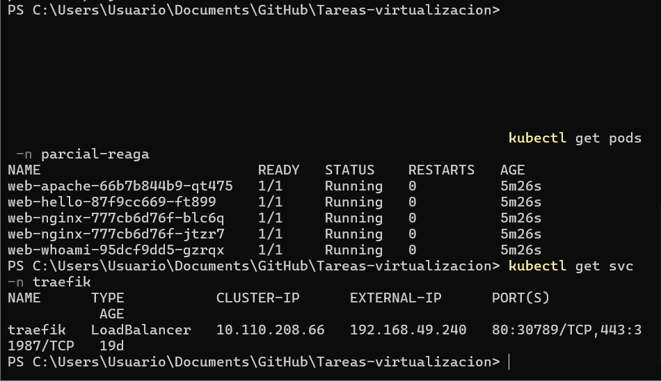

The branch was created from `main`:

```powershell
git checkout main
git pull origin main
git checkout -b personal-project-01
```

## 1. Namespace and Helm repositories

```powershell
kubectl apply -f personal-project-01\manifests\namespace.yaml

helm repo add prometheus-community https://prometheus-community.github.io/helm-charts
helm repo add grafana https://grafana.github.io/helm-charts
helm repo update
```

Four independent Helm releases are used, all in `monitoring-reaga`: `prometheus`, `loki`, `promtail` and `grafana`.

## 2. Prometheus

`helm-values/prometheus-values.yaml`:

```yaml
alertmanager:
  enabled: false

prometheus-pushgateway:
  enabled: false

kube-state-metrics:
  enabled: true

prometheus-node-exporter:
  enabled: true

server:
  global:
    scrape_interval: 15s
    evaluation_interval: 15s
  retention: 2d
  persistentVolume:
    enabled: false
  service:
    type: ClusterIP
```

```powershell
helm upgrade --install prometheus prometheus-community/prometheus `
  --namespace monitoring-reaga `
  -f personal-project-01\helm-values\prometheus-values.yaml
```

- `kube-state-metrics` provides the pod state metrics.
- `node-exporter` provides node metrics.
- The chart's default scrape jobs include the Kubernetes API server, the kubelet and cAdvisor (CPU and memory per container).
- Persistence is disabled for Prometheus (2 days of retention): data is lost if the pod restarts, which is acceptable for this activity.

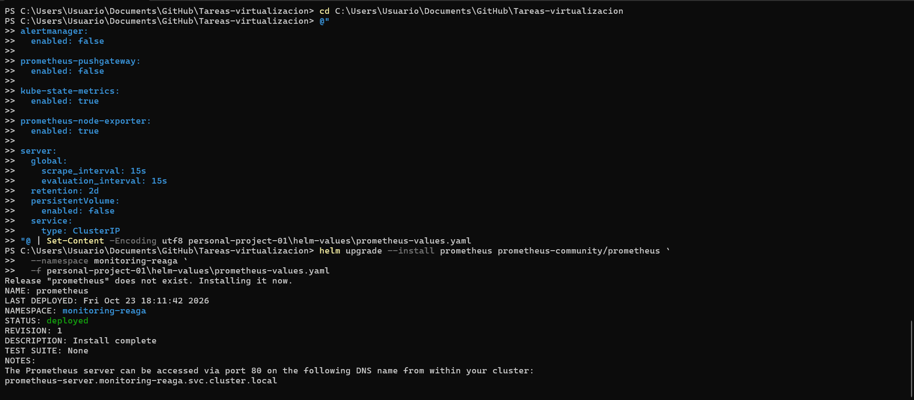

## 3. Loki

`helm-values/loki-values.yaml` (single binary, filesystem storage on a PVC):

```yaml
deploymentMode: SingleBinary

loki:
  auth_enabled: false
  commonConfig:
    replication_factor: 1
  schemaConfig:
    configs:
      - from: "2024-04-01"
        store: tsdb
        object_store: filesystem
        schema: v13
        index:
          prefix: loki_index_
          period: 24h
  storage:
    type: filesystem
  limits_config:
    allow_structured_metadata: true
    volume_enabled: true

singleBinary:
  replicas: 1
  persistence:
    enabled: true
    size: 1Gi

read:
  replicas: 0
write:
  replicas: 0
backend:
  replicas: 0

gateway:
  enabled: false
chunksCache:
  enabled: false
resultsCache:
  enabled: false
lokiCanary:
  enabled: false
test:
  enabled: false
```

```powershell
helm upgrade --install loki grafana/loki `
  --namespace monitoring-reaga `
  -f personal-project-01\helm-values\loki-values.yaml
```

Loki is reachable inside the cluster at `http://loki.monitoring-reaga.svc.cluster.local:3100`. The readiness check (`/ready`) returns `ready`.

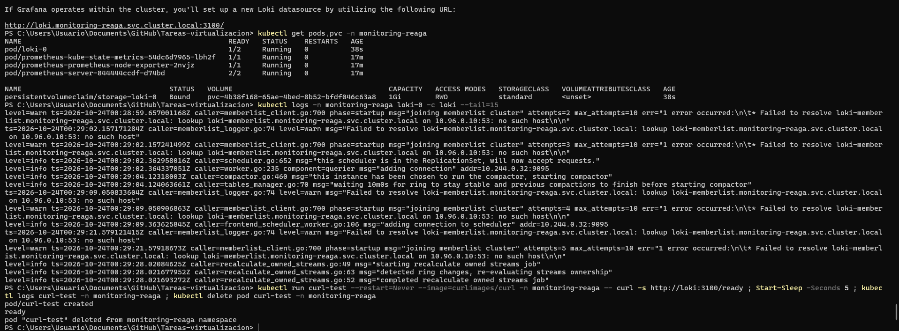

## 4. Promtail (DaemonSet)

`helm-values/promtail-values.yaml`:

```yaml
config:
  clients:
    - url: http://loki.monitoring-reaga.svc.cluster.local:3100/loki/api/v1/push

tolerations:
  - operator: Exists
```

```powershell
helm upgrade --install promtail grafana/promtail `
  --namespace monitoring-reaga `
  -f personal-project-01\helm-values\promtail-values.yaml
```

The chart deploys Promtail as a DaemonSet (one pod per node) with Kubernetes service discovery. It tails the container logs of every pod in the cluster and labels each stream with `namespace`, `pod`, `container` and `app`. That covers the 4 apps in `parcial-reaga` and Traefik without per-app configuration.

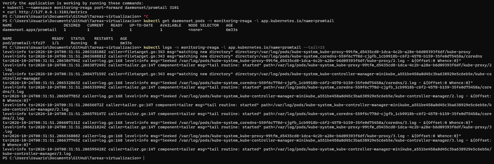

To confirm that Loki receives the logs of each pod, traffic was generated against the 4 apps and Loki was queried from inside the cluster:

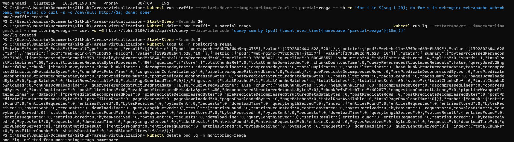

### Traefik access logs

By default Traefik only logs its own events, not every HTTP request. Access logs were enabled with `helm-values/traefik-access-logs-values.yaml`:

```yaml
logs:
  access:
    enabled: true
```

```powershell
helm upgrade traefik traefik/traefik `
  --namespace traefik `
  --reuse-values `
  -f personal-project-01\helm-values\traefik-access-logs-values.yaml
```

## 5. Grafana

### Data sources as code (provisioning)

The data sources are declared in `helm-values/grafana-values.yaml`; the chart turns them into a provisioning file that Grafana loads at startup. Nothing is configured by hand in the UI.

```yaml
adminUser: admin

persistence:
  enabled: false

service:
  type: ClusterIP

datasources:
  datasources.yaml:
    apiVersion: 1
    datasources:
      - name: Prometheus
        uid: prometheus
        type: prometheus
        access: proxy
        url: http://prometheus-server.monitoring-reaga.svc.cluster.local
        isDefault: true
      - name: Loki
        uid: loki
        type: loki
        access: proxy
        url: http://loki.monitoring-reaga.svc.cluster.local:3100

sidecar:
  dashboards:
    enabled: true
    label: grafana_dashboard
    labelValue: "1"
    searchNamespace: monitoring-reaga

dashboardProviders:
  dashboardproviders.yaml:
    apiVersion: 1
    providers:
      - name: sidecarProvider
        orgId: 1
        folder: ''
        type: file
        disableDeletion: false
        allowUiUpdate: true
        options:
          path: /tmp/dashboards
```

```powershell
helm upgrade --install grafana grafana/grafana `
  --namespace monitoring-reaga `
  -f personal-project-01\helm-values\grafana-values.yaml
```

The admin password is generated by the chart and is not stored in the repository. It is read from the secret:

```powershell
kubectl get secret grafana -n monitoring-reaga -o jsonpath='{.data.admin-password}' | ForEach-Object { [Text.Encoding]::UTF8.GetString([Convert]::FromBase64String($_)) }
```

### Dashboards as code

Two dashboards are stored as JSON in `dashboards/` and loaded through ConfigMaps labeled `grafana_dashboard=1`. The Grafana sidecar watches that label and copies the JSON into `/tmp/dashboards`, where the provider picks it up.

```powershell
kubectl apply -f personal-project-01\manifests\dashboard-cluster-metrics-cm.yaml
kubectl apply -f personal-project-01\manifests\dashboard-app-logs-cm.yaml
kubectl get cm -n monitoring-reaga -l grafana_dashboard=1
```

- **Cluster Metrics:** CPU per pod, memory per pod, pods by phase and Running pods per namespace (Prometheus).
- **Application Logs:** one log panel per app (`web-nginx`, `web-apache`, `web-whoami`, `web-hello`) plus a Traefik panel (Loki).

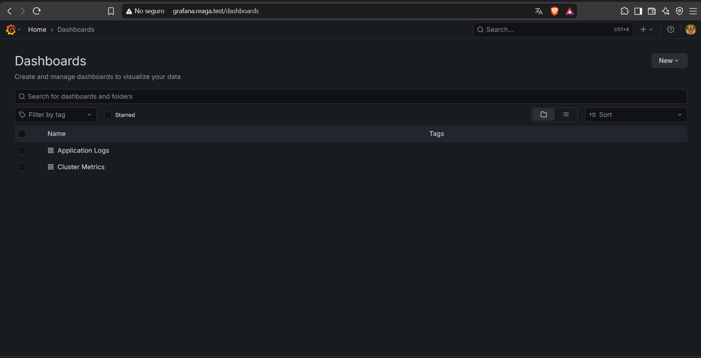

## 6. Exposure through Traefik and local DNS

`manifests/monitoring-ingress.yaml` routes each host to its service through the `traefik` IngressClass:

```yaml
apiVersion: networking.k8s.io/v1
kind: Ingress
metadata:
  name: monitoring-ingress
  namespace: monitoring-reaga
spec:
  ingressClassName: traefik
  rules:
    - host: grafana.reaga.test
      http:
        paths:
          - path: /
            pathType: Prefix
            backend:
              service:
                name: grafana
                port:
                  number: 80
    - host: prometheus.reaga.test
      http:
        paths:
          - path: /
            pathType: Prefix
            backend:
              service:
                name: prometheus-server
                port:
                  number: 80
```

```powershell
kubectl apply -f personal-project-01\manifests\monitoring-ingress.yaml
kubectl get ingress -n monitoring-reaga
```

The Ingress gets the MetalLB address `192.168.49.240`. Requests through Traefik with the right `Host` header return `200` for Grafana and `302` (redirect to `/query`) for Prometheus.

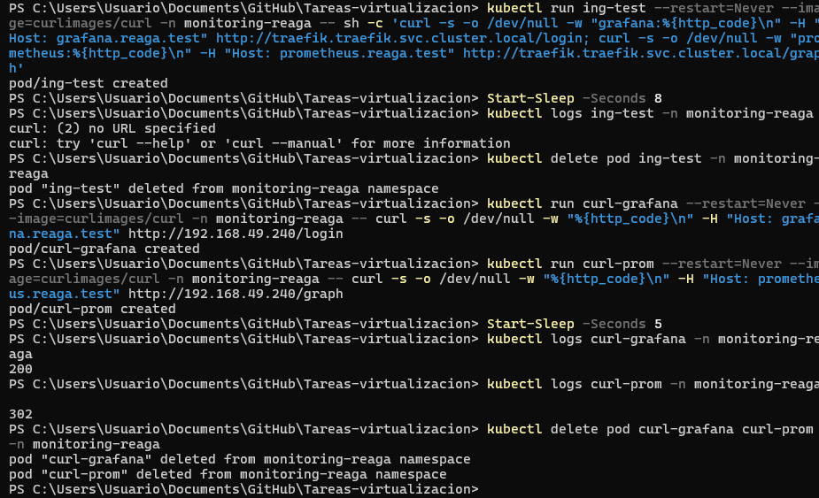

### DNS (`C:\Windows\System32\drivers\etc\hosts`)

Official configuration (LoadBalancer IP from MetalLB):

```
192.168.49.240 grafana.reaga.test
192.168.49.240 prometheus.reaga.test
```

As in the previous activity, Windows with the Docker driver cannot reach `192.168.49.240` (that address only exists inside the Minikube Docker network). To open the pages in the browser, the hosts entries were temporarily pointed to `127.0.0.1` and Traefik was exposed with a port-forward in a PowerShell opened as administrator (port 80 requires it):

```
127.0.0.1 grafana.reaga.test
127.0.0.1 prometheus.reaga.test
```

```powershell
kubectl port-forward -n traefik svc/traefik 80:80
```

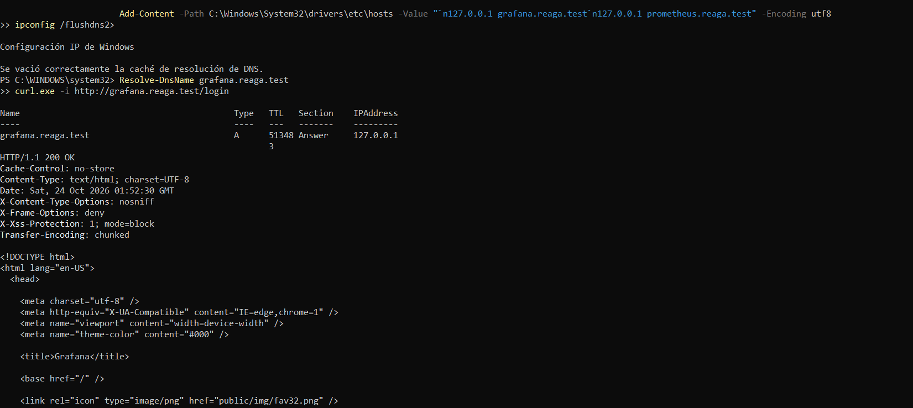

## 7. Evidence

### Grafana and Prometheus by domain name

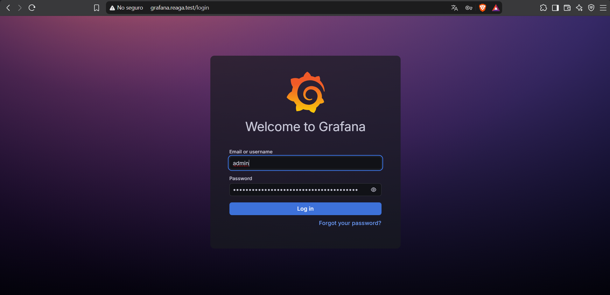

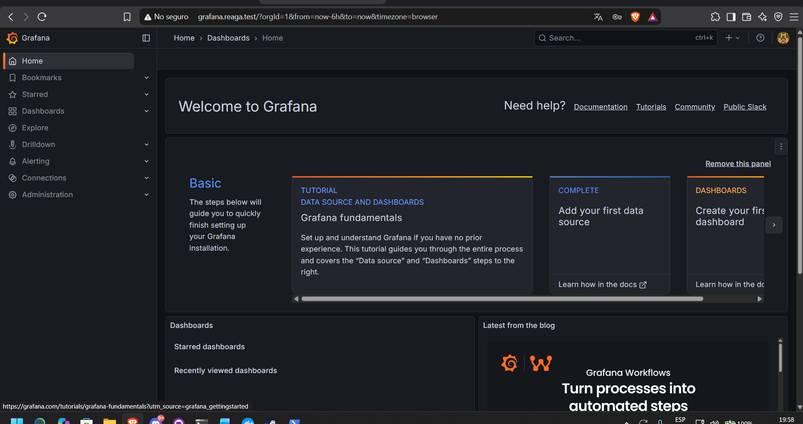

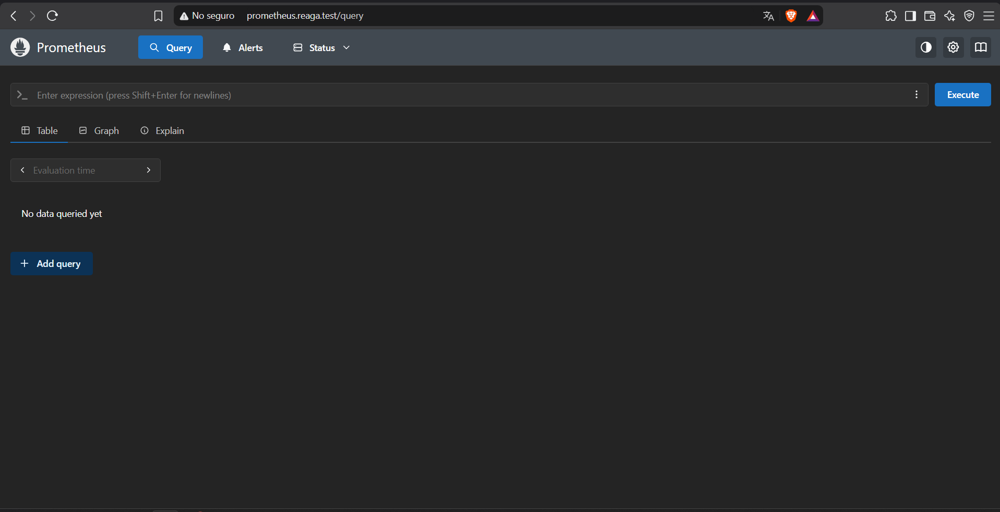

### Prometheus targets

`http://prometheus.reaga.test/targets` — all scrape pools with their targets in state **UP**.

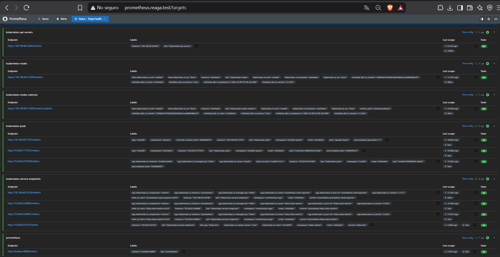

### Metrics dashboard

CPU, memory and pod state of the cluster.

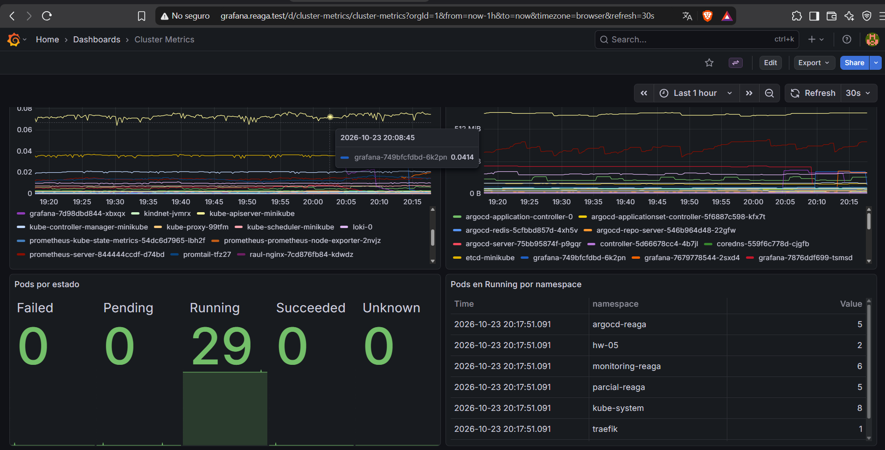

### Logs dashboard

Logs of the 4 apps in `parcial-reaga` (`web-nginx`, `web-apache`, `web-whoami`, `web-hello`), queried from Loki.

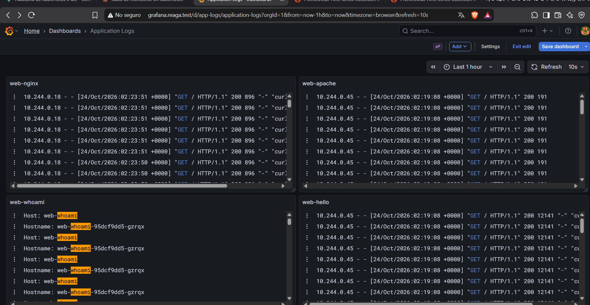

Traefik panel of the same dashboard:

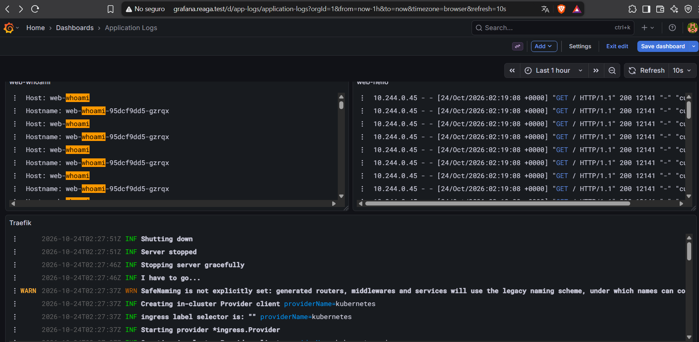

## 8. Troubleshooting

### 8.1 Loki: `read-only file system` with persistence disabled

- **Symptom:** `loki-0` in `CrashLoopBackOff` (`1/2`). Log: `mkdir /var/loki: read-only file system error initialising module: ruler-storage`.
- **Cause:** with `singleBinary.persistence.enabled: false` there is no writable volume at `/var/loki`, and the container root filesystem is read-only.
- **Fix:** persistence was enabled (a 1Gi PVC with the default `standard` StorageClass). The StatefulSet cannot change its volumes on upgrade, so the release and its PVC were removed first:

```powershell
helm uninstall loki -n monitoring-reaga
kubectl delete pvc -n monitoring-reaga -l app.kubernetes.io/name=loki
```

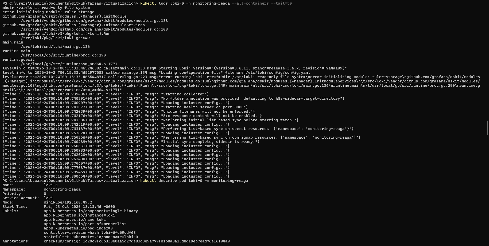

### 8.2 Loki: invalid key in `storage.filesystem`

- **Symptom:** `failed parsing config: /etc/loki/config/config.yaml: yaml: unmarshal errors: field admin_api_directory not found in type common.FilesystemConfig`.
- **Cause:** an extra key (`admin_api_directory`) was added under `storage.filesystem` in `loki-values.yaml`; it does not exist in Loki 3.x.
- **Fix:** the explicit `filesystem` block was removed. Only `storage.type: filesystem` remains, and Loki's default paths are used with the PVC from 8.1.

### 8.3 Test pod cannot attach (`curl-test`)

- **Symptom:** `kubectl run ... -it` failed with `error attaching to container ... no running task found`.
- **Cause:** Docker Desktop fails to attach a terminal to short-lived pods. It is not a Loki problem.
- **Fix:** run the pod without `-it`, wait a few seconds and read its output with `kubectl logs`, then delete it.

### 8.4 Hosts file entries not taking effect

- **Symptom:** `curl.exe http://grafana.reaga.test/login` returned `Could not resolve host`, although the pages worked with a forced `Host` header.
- **Cause:** the new entries had not been saved correctly in the real `hosts` file.
- **Fix:** the file was corrected (opened as administrator, saved as `hosts` with no extension), the cache was flushed with `ipconfig /flushdns` and `Resolve-DnsName grafana.reaga.test` returned `127.0.0.1`.

### 8.5 Dashboards not loaded: UTF-8 BOM in the JSON

- **Symptom:** the sidecar copied `app-logs.json` and `cluster-metrics.json` to `/tmp/dashboards`, but the dashboards did not appear. Grafana log: `logger=provisioning.dashboard type=file name=sidecarProvider error="invalid character 'ï' looking for beginning of value"`.
- **Cause:** the files were written from Windows PowerShell 5.1 with `Set-Content -Encoding utf8`, which adds a UTF-8 byte order mark (`0xEF 0xBB 0xBF`). Grafana's JSON parser rejects it.
- **Fix:** the JSON files were rewritten as UTF-8 without BOM, the ConfigMaps were recreated with the label `grafana_dashboard=1` and the Grafana deployment was restarted.

```powershell
$utf8NoBom = New-Object System.Text.UTF8Encoding $false
Get-ChildItem -Path "personal-project-01\dashboards\*.json" | ForEach-Object {
  $content = Get-Content $_.FullName -Raw
  [System.IO.File]::WriteAllText($_.FullName, $content, $utf8NoBom)
}
kubectl rollout restart deployment grafana -n monitoring-reaga
```

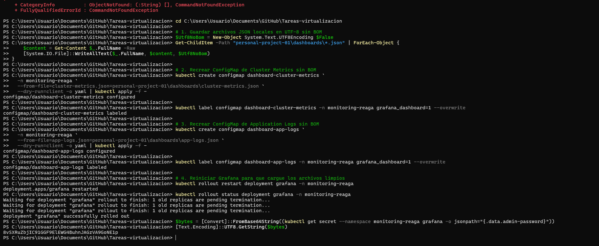

### 8.6 LogQL filter for `web-whoami` returned "No data"

- **Symptom:** the `web-whoami` panel showed "No data" while `web-nginx`, `web-apache` and `web-hello` had logs.
- **Cause:** the original selector did not match the labels of the whoami pod.
- **Fix:** the query was changed to filter by namespace and by text: `{namespace="parcial-reaga"} |= "whoami"`.

### 8.7 Traefik panel empty: no access logs

- **Symptom:** the Traefik panel showed "No data" while traffic went through the Ingress.
- **Cause:** Traefik ships with access logs disabled in its Helm chart.
- **Fix:** access logs were enabled with a Helm upgrade (`logs.access.enabled=true`, see section 4), Traefik was restarted and the panel query was set to `{namespace="traefik"}`.

### 8.8 Windows cannot reach the MetalLB IP

- **Symptom:** the `*.reaga.test` domains did not open in the browser when they pointed to `192.168.49.240`.
- **Cause:** with the Minikube `docker` driver on Windows, the LoadBalancer IP is only reachable inside the Docker network, not from the host.
- **Fix:** hosts entries to `127.0.0.1` plus `kubectl port-forward -n traefik svc/traefik 80:80` (section 6). The official configuration with `192.168.49.240` is documented above.

## 9. Notes

- Prometheus and Grafana run without persistence; their data is lost if the pods restart. Loki keeps its data on a 1Gi PVC.
- Dashboards and data sources are recreated automatically from the repository files, so nothing is lost when Grafana restarts.
- The Grafana admin password is generated by the chart and is intentionally not committed.
